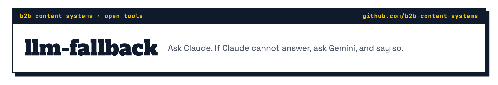

<picture>
  <source media="(prefers-color-scheme: dark)" srcset=".github/assets/header-llm-fallback-dark.png">
  
</picture>

[](https://github.com/b2b-content-systems/llm-fallback/actions/workflows/tests.yml)


Ask Claude. If Claude cannot answer, ask Gemini, and say so.

I run marketing tools that call an AI model all day: film briefs, document pipelines, a church's weekly bulletin. When the model is down, rate-limited or out of credit, the tool should keep working and tell me which model answered. When my own request is wrong, it should fail loudly instead of hiding the bug behind a second model. This file does both.

```python
from llm_fallback import ask

a = ask("Write a two-line product update for a product launch.", system="Plain English.")
print(a.text)
print(a.model, a.fallback_reason)   # e.g. "gemini-3.6-flash", "Claude unavailable (529)"
```

## What it does

| Claude says | What happens |
|---|---|
| answers | you get Claude's answer |
| no key, 401, 403 | Gemini answers; `fallback_reason` says why |
| 408, 429, 5xx, network down | Gemini answers; `fallback_reason` says why |
| 400 (your request is wrong) | raises `BadRequest`; no fallback |
| both down | raises `Unavailable` with both reasons |

## Images and JSON

```python
from llm_fallback import ask_gemini, Image, ModelGone

a = ask_gemini("What does this screenshot say?", images=[Image(open("shot.png", "rb").read())],
               json_schema={"type": "object", "properties": {"text": {"type": "string"}}})
if a.cut_off:   # the reply hit the token limit
    ...
```

Gemini gets the schema natively (`responseJsonSchema`); Claude gets it as an instruction. For pictures,
`ask_gemini(prompt, model="gemini-3.1-flash-image", output="image")` returns them in `Answer.images`; a content
refusal comes back as `Answer.finish == "refused"`, not an exception. A model id that no
longer exists raises `ModelGone` (a `BadRequest`), so you can move to the next one.

## Settings each model accepts

A fallback is useless if the second model rejects the call. Each provider gets only the settings it takes:

- **Claude 5 and Opus 4.7+:** `temperature` is dropped.
- **Gemini 2.x:** `thinkingBudget` and `temperature`.
- **Gemini 3.x and later:** `thinkingLevel: "low"`, no `temperature`, `topP` or `topK`. Thinking counts against the output limit, so the call gets 500 tokens of extra room.

## Install

Python 3.10 or later, standard library only. If `certifi` is installed it uses its certificates (python.org builds on macOS ship without any). Copy `llm_fallback.py` into your project and set the keys:

```
export ANTHROPIC_API_KEY=...
export GEMINI_API_KEY=...
python llm_fallback.py "Say hello in five words."
```

Change the defaults with `claude_model=` and `gemini_model=`. Pass `transport=` to test without the network (see the tests).

MIT licence.

---

An open tool from **B2B Content Systems**, Bryan Bartlett, Boston, MA. More at [github.com/b2b-content-systems](https://github.com/b2b-content-systems) and [bryanbartlett.com](https://bryanbartlett.com).
